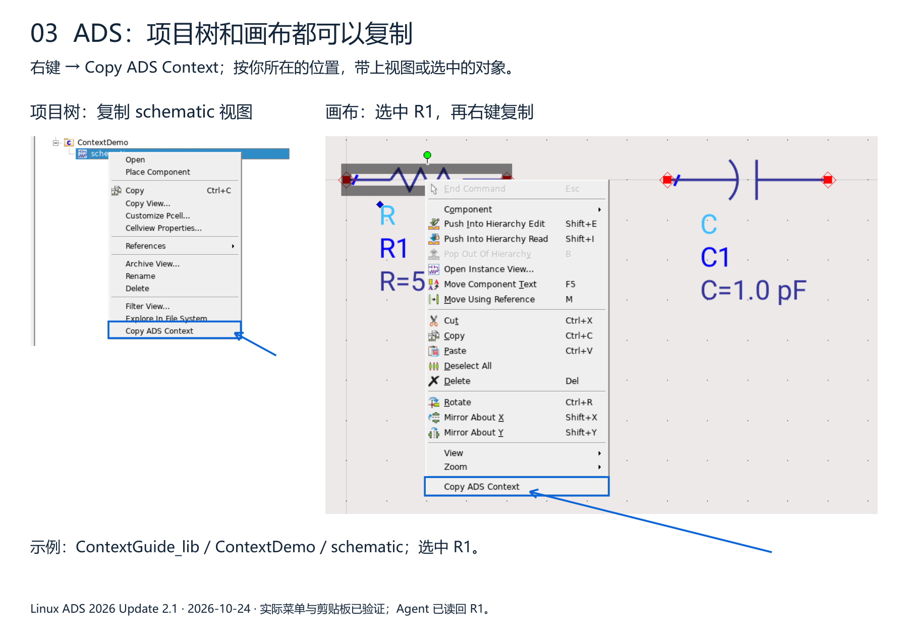
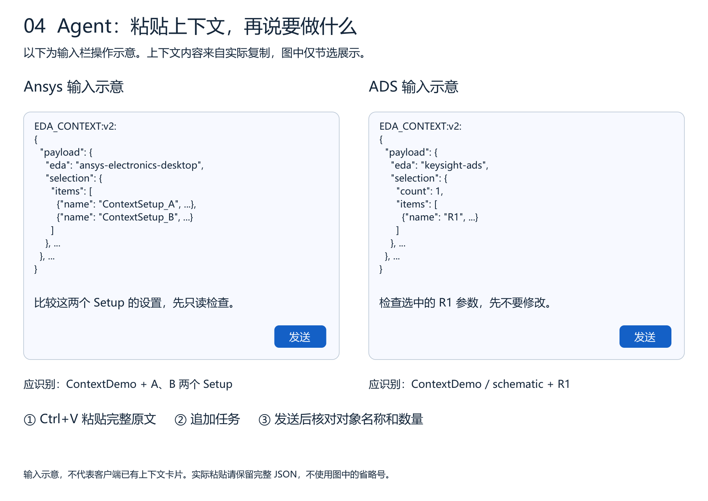

# Copy ADS context

[Download the illustrated guide (PDF)](https://github.com/cottman99/ads-agent-bridge/releases/download/v0.2.0a2/ADS-Context-Guide.pdf).

Use **Copy ADS Context** in the project tree to share a view, or on the schematic canvas to share the selected component.

Paste the complete copied text into your Agent input and add your request. The input illustration below abbreviates JSON for readability; do not paste the abbreviated example.

Verified in Linux ADS 2026 Update 2.1: the tree copied the schematic view, and the canvas copied R1. MCP independently checked the exact design and R1 in that design.
