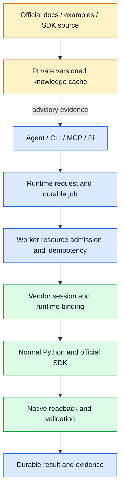

# Native execution architecture

Agent code reaches official vendor APIs through one `native.execute` operation.
The request schema is `eda.native-program/v1`. This is a breaking alpha upgrade;
the previous native protocol and unrestricted compatibility entry points are removed.

Runtime owns request identity, durable jobs, resource admission, process supervision,
structured errors and evidence. Each Bridge owns SDK binding, target identity,
native readback and its private knowledge partition. Installing one Bridge brings
the Runtime library as a dependency; another Bridge and a separate knowledge service
are not required. Local and SSH services run the same code on the EDA host.

| Field | Meaning |
| --- | --- |
| `runtime` | Official SDK environment selected by the vendor Bridge |
| `mode` | `live`, `background` or `offline`, where that backend supports it |
| `effect` | `observe` or `mutate`; independent of the mode |
| `program` | Python with `run(api, context)` returning a JSON object |
| `scope` | Exact resource, version, input paths, output paths and artifacts |
| `transaction` | Live readback or staged output with source fingerprints |
| `validation` | `validate(api, context)` returning `status: passed` and measured facts |
| `limits` | Deadline and bounded output |

Programs use normal Python builtins and installed dependencies. There is no module
allowlist or global unsafe switch. New official SDK methods do not require new
Bridge wrappers. Declared scope is an operational contract, not an OS sandbox.
SDK availability, target freshness, task authorization and engineering validation
remain separate facts.

All native programs, including `effect: observe`, use `eda.submit` with a stable
idempotency key. `eda.read` is reserved for registered deterministic observations.
A program completes only when its execution and requested verification complete;
launching a job or opening a GUI is not acceptance.

Background/offline mutations copy the source, execute, save, reopen, validate and
promote to a new output. Live programs bind the exact existing session and validate
in that session; they do not claim a fresh reopen or automatic general rollback.
An arbitrary SDK call cannot be made transactional by declaring it so.

Worker coordination uses canonical project identities shared by connection aliases.
Resource leases never transfer merely because a timer expires. An uncertain result
blocks conflicting writes and never triggers automatic replay. Use job status,
events and the run receipt after reconnecting. `eda.job.cancel` cancels queued work
and requests cooperative cancellation of running work. Owned native subprocesses
are terminated at their deadline/cancellation boundary; an in-flight live vendor call
may finish, so the target remains uncertain until verified.

Worker administration can inspect `eda-runtime resources status` and reconcile an
uncertain lease with its exact owner/token and a fresh vendor observation. The
observation and purpose are recorded. Reconciliation does not undo engineering data.
Known completed failure stages retain eight recent copies for up to seven days;
cleanup runs on subsequent failures. Uncertain stages are retained for investigation.

Knowledge prepares automatically from supported installed sources when first used.
Original manuals, existing Markdown and SDK sources are preserved. Generated caches
are private, version scoped, fingerprinted and protected by one build lock. A missing
or partial corpus does not disable execution. SDK signatures/docstrings are evidence
of source behavior, not proof of a successful native call. Experience assets advise
the Agent; compiled workflow execution never imports them as product logic.

Upgrade the Runtime and selected Bridge together, then refresh the transport and
restart only an owned session that needs the new embedded add-on. Do not load old
and new writers onto the same target. An older complete installation is the rollback
unit; the new package has no switch to revive the old executor.

The vendor Skill distributed in this package lists its exact backend bindings and object contracts.
